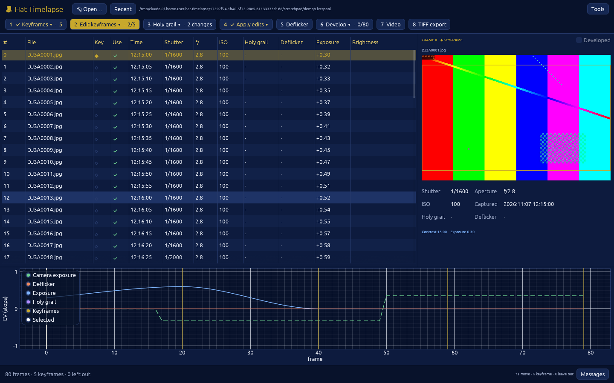

## What's in this release

**New in 0.3**
- **Fixed: keyframe edits could be lost.** Running Holy grail or Deflicker
  after editing keyframes, but before applying the edits, overwrote the
  keyframes' exposure. Every step now re-reads your keyframes first, so steps
  can be taken in any order.
- **Stale editor saves are recognised.** If Lightroom saves a keyframe without
  first re-reading Hat Timelapse's changes, the corrections are no longer
  counted twice.
- **Clearer workflow in the app:** a new **2 Edit keyframes** step with
  instructions for Lightroom or LightCraft and a live count of saved
  keyframes; **4 Apply edits** (previously Read keyframes); a single
  **6 Develop** step for LightCraft or a Lightroom export; the suggested next
  step in solid gold; **Holy grail** says how many camera exposure changes it
  found, or that it isn't needed; a dashed camera-exposure line on the graph;
  keyframe markers showing edit status; and a reminder to re-read the frames
  in your editor after each step.
- TIFF export now uses the chosen Lightroom export folder.

**From 0.2: the Hat Timelapse desktop app.** Open a sequence folder and work
through numbered steps, with a frame table, a preview showing the video
framing, and a graph of exposure and brightness you can click to move through
the frames. Rendering and encoding show progress and can be cancelled. On
macOS it installs as a normal app (disk image or installer); on Linux it
appears in your applications menu; on Windows it is `hat_timelapse_app.exe`.



Everything from 0.1 is included:

- **Keyframes**: edit a few frames and every frame in between follows,
  smoothly. Settings you don't animate are copied from the first keyframe to
  every frame.
- **Holy grail**: shutter, aperture and ISO changes during day-to-night shoots
  are compensated automatically.
- **Deflicker**: brightness is measured on every frame and flicker removed,
  while sunsets and keyframed changes are kept.
- **LightCraft rendering**: full-resolution 16-bit or 32-bit float TIFF.
  Tested with LightCraft 0.20.0 and Canon EOS R CR3 files.
- **Video**: H.264, HEVC, AV1, ProRes 422 HQ / 4444 / 4444 XQ and
  DNxHR HQ / HQX / 444, from HD to 8K and beyond, with motion blur.
- **Colour and HDR**: Rec.709, Display P3, Rec.2020, HDR10 (PQ) and HLG.
- **Pan and zoom** keyframes.
- **TIFF sequences** for EffectCraft and FilmCraft.
- **Long-term and construction filters**: working hours, weekdays, one frame
  per day, and frames much brighter or darker than their neighbours.
- **Batch**: many sequences, several formats, one command.

## Install

**macOS and Linux**: in Terminal, run:

```bash
curl -fsSL https://raw.githubusercontent.com/neilmanfredit/hat_timelapse/main/install.sh | sh
```

This installs the app and the `hat_timelapse` command.

**macOS by hand**: download `HatTimelapse-…-macos.dmg` below and drag the app to
Applications. The first time, right-click the app and choose **Open**: it is
not yet signed with an Apple developer certificate.

**Windows**: download `hat_timelapse-…-windows-x86_64.zip` below and unzip it.
Run `hat_timelapse_app.exe`, keeping `hat_timelapse.exe` in the same folder.

Then install the companion tools: LightCraft's command-line tool, ffmpeg and
exiftool. Check everything with:

```bash
hat_timelapse doctor
```

Full steps for each system, including LightCraft's separate macOS download:
[Installation guide](https://github.com/neilmanfredit/hat_timelapse/blob/main/docs/INSTALL.md).

## Quick start

```bash
cd ~/Timelapses/my-sequence
hat_timelapse init --keyframes 3
hat_timelapse keyframes label
hat_timelapse holy-grail          # only if you changed exposure during the shoot
# edit the keyframes in LightCraft or Lightroom and save metadata (⌘S)
hat_timelapse interpolate
hat_timelapse deflicker
hat_timelapse render
hat_timelapse video --size 4k --codec h264
```

Step-by-step instructions, options and recipes:
[User guide](https://github.com/neilmanfredit/hat_timelapse/blob/main/docs/USER_GUIDE.md).

## Downloads

| File | For |
| --- | --- |
| `HatTimelapse-…-macos.dmg` | macOS 11 or later, Apple silicon and Intel: drag to Applications |
| `hat_timelapse-…-macos-universal.tar.gz` | macOS, used by the installer (app and command line) |
| `hat_timelapse-…-linux-x86_64.tar.gz` | Linux on Intel/AMD |
| `hat_timelapse-…-linux-aarch64.tar.gz` | Linux on ARM (Raspberry Pi 5, Ampere, etc.) |
| `hat_timelapse-…-windows-x86_64.zip` | Windows 10 and 11 |
| `SHA256SUMS.txt` | Checksums to verify the downloads |
